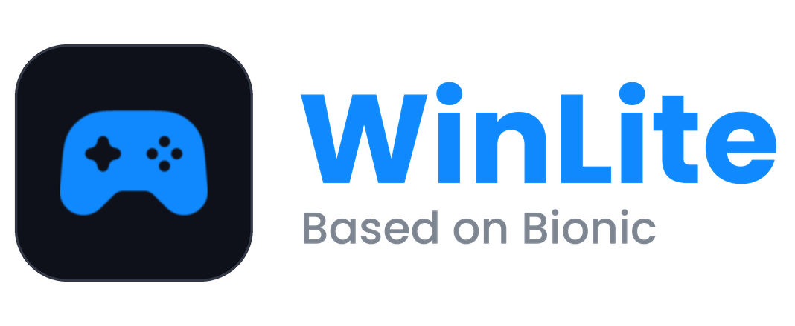

<p align="center">
  
</p>

# WinLite — Winlator Bionic(ludasho) fork

Android app for running Windows (x86\_64) games and apps via Wine. Supports `x86_64` containers (Box86/Box64) and `Arm64EC` containers (FEXCore, optional WowBox64).

Fork of [Winlator-Ludashi](https://github.com/StevenMXZ/Winlator-Ludashi) by StevenMXZ, itself based on [Winlator Bionic](https://github.com/Pipetto-crypto/winlator). Focus: built-in frame generation, a fully rewritten interface, lighter containers and safer game saves.

## Why this fork

| Feature | What you get |
|---|---|
| 🎞️ **Frame generation (LSFG)** | Built into the Vulkan renderer: 2x / 3x / 4x or Adaptive FPS. No external layers. |
| 🎨 **Compose UI** | Whole app rewritten in Jetpack Compose, plus a new in-game sidebar. |
| 🔊 **DirectAudio** | Wine → AAudio driver for low-latency sound (Proton 11 Arm64EC). |
| 🧩 **3 Vulkan wrappers** | Default, Adreno and Legacy — pick what suits your GPU. |
| 💾 **Thin containers** | Much smaller containers via a shared base prefix and shared components. |
| 🗂️ **Save profiles** | Saves live in `Winlator/saves` and survive any container change. |
| 🕹️ **Dynamic Stick** | On-screen stick that appears under your finger and follows it. |
| 📦 **Component catalog** | One place for Proton, drivers and runtimes, with editable download sources. |

## Features

### 🎞️ Frame generation (LSFG Native)
- Modes: **2x, 3x, 4x** or **Adaptive FPS** (output paced to a target FPS you set).
- Adjustable flow scale; switch on the fly from the sidebar; set per container or per shortcut.
- **Requires your own `Lossless.dll`** — it isn't bundled. Import it once in Settings.

### 🎨 Interface
- Library, game details, containers, shortcuts, settings, file manager and controls editor are all Compose.
- **In-game sidebar** with Rendering, HUD, Screen, Input and Task Manager panels.
- Game covers and banners from SteamGridDB / TheGamesDB, with optional animated artwork.
- Portrait and landscape layouts, themes, HUD (FPS, CPU/GPU load, RAM, power, temperature), debug log viewer.

### 🖼️ Image quality
- Upscalers: SGSR, FSR, Lanczos 2, Color Boost (with sharpness).
- Post effects: DLS, CRT, HDR, Natural.
- 12 ReShade-style presets with adjustable strength (Cinematic, Vivid, Retro CRT, Anime Edge, …).
- FPS limiter (any value) and selectable surface format.

### 🧩 Graphics & audio
- Wrappers: **Default / Adreno / Legacy**. Adreno is preselected when supported.
- Bundled Turnip/Adreno drivers; OpenGL via Zink or freedreno.
- **DirectAudio** (Proton 11 Arm64EC): AAudio output, optional microphone, 64- and 32-bit guests. Based on [The412Banner/directaudio](https://github.com/The412Banner/directaudio).

### 💾 Thin containers
- Each container stores only its own changes on top of one shared **base prefix** per Wine/Proton version (copy-on-write overlay; Wine is not modified).
- DXVK, VKD3D, FEXCore and other components are stored once and shared (e.g. the 228 MB Direct3D pack exists once, not per container).
- Result: small containers, fast creation.

### 🗂️ Save profiles & backups
Normally saves die with the container. A save profile keeps them in Android storage and links them into whichever container you launch from.

- **Mode per shortcut:** *Off* (default) · *Own* (`Winlator/saves/<Game>/`) · *Shared* (`Winlator/saves/_Common/`).
- **Covers:** `AppData`, `Documents`, `Saved Games`, `Public Documents` **and registry keys** (Unity PlayerPrefs, older games).
- **Safe:** matched by id (renaming is fine); a re-added game picks its old saves up again; other games in the same container are untouched.
- **Backups** (`Winlator/backups/<Game>/`): manual, automatic on exit (only if saves changed), and a "before restore" snapshot.
- Deleting a shortcut offers to delete its saves too (default: keep).

### 🕹️ Input
- **Dynamic Stick** (off by default): touch anywhere in the stick's zone and it appears under your finger; drag past its rim and it follows; release and it returns home. Buttons inside the zone keep priority. Tune *Zone Size* (1.5×–5×) and *Follow Speed* per stick.
- Proper relative mouse and DirectInput on Wine 10+ / Proton 11 (XInput2 in the built-in X server).
- Smooth, refresh-rate-independent touch pointer acceleration.
- Gamepad mode per container/shortcut: XInput, DInput, both or none.
- Haptics, magnifier, Tap to Click, Relative Mouse and Cursor Speed in the sidebar.

### 📦 Components & sources
- One catalog for Proton/Wine, GPU drivers, FEXCore/Box64, DXVK/VKD3D and more, with verified downloads.
- **Winlator Services:** replace any download address (components, drivers, controls, artwork) with your own mirror.
- GitHub "channels" for app updates and component catalogs.

## Compared to Ludashi 4.1

| | Ludashi 4.1 | WinLite |
|---|---|---|
| Frame generation | — | LSFG 2x–4x, Adaptive FPS |
| UI | XML + Fragments | Jetpack Compose |
| Audio | PulseAudio / ALSA | ALSA + DirectAudio |
| Vulkan wrapper | 1 | 3 |
| Containers | Full copy each | Thin overlay + shared components |
| Saves | In container | Save profiles + backups |
| On-screen stick | Fixed | Optional Dynamic Stick |
| Image effects | — | Upscalers, post-FX, 12 ReShade presets |
| Download sources | Hardcoded | Editable in-app |
| Artwork | — | SteamGridDB / TheGamesDB |

Removed to stay lean: OpenGL (EGL) renderer, PulseAudio, OpenXR and Big Picture mode.

## Installation
1. Download the latest APK from [Releases](../../releases).
2. Install, launch and wait for first-time setup.
3. Create a container, choose Wine/Proton, add your game.

Package: `com.winlite.bionic` · Arm64 only · Android 9+ (`minSdk 28`)

## Tips
- Frame generation: import `Lossless.dll` in Settings, then choose LSFG in sidebar → Rendering.
- DirectAudio needs a Proton 11 Arm64EC container.
- Slow `x86_64` container: set the Box86/Box64 preset to **Performance** (Container → Advanced); use **Intermediate** for installers.
- `Arm64EC` container: try other FEXCore versions.
- .NET apps: install Wine Mono (Start Menu → System Tools).
- Old games not starting: add `MESA_EXTENSION_MAX_YEAR=2003` to environment variables.
- Launch games from their shortcuts — each has its own settings.

## Building
JDK 17, Android SDK (compileSdk 35), NDK, `glslang-tools`, `ninja`, `zstd`. See `.github/workflows/build.yml` for exact steps (it also fetches `libadrenotools` and `liblinkernsbypass` at pinned commits).

```bash
chmod +x gradlew
./gradlew assembleRelease
```

## Credits
[Winlator](https://github.com/brunodev85/winlator) (brunodev85) · [Winlator Bionic](https://github.com/Pipetto-crypto/winlator) (Pipetto-crypto) · [Winlator-Ludashi](https://github.com/StevenMXZ/Winlator-Ludashi) (StevenMXZ) · [coffincolors fork](https://github.com/coffincolors/winlator) · [DirectAudio](https://github.com/The412Banner/directaudio) (The412Banner) · LSFG shader/engine code from the Eden Emulator Project (see `lsfg/LICENSE`) · Lossless Scaling by THS

[Wine](https://www.winehq.org/) · [Box86/Box64](https://github.com/ptitSeb) · [FEX-Emu](https://github.com/FEX-Emu/FEX) · [PRoot](https://proot-me.github.io) · [Mesa](https://www.mesa3d.org) · [DXVK](https://github.com/doitsujin/dxvk) · [VKD3D](https://gitlab.winehq.org/wine/vkd3d) · [D8VK](https://github.com/AlpyneDreams/d8vk) · [CNC DDraw](https://github.com/FunkyFr3sh/cnc-ddraw)

## License
See [LICENSE](LICENSE).
